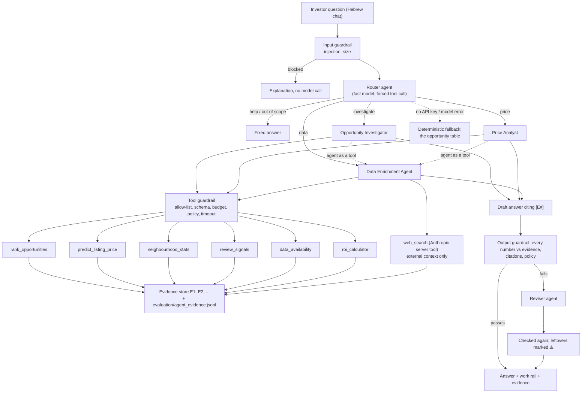

# Agents, tools and guardrails

**Owner:** agent, tools, guardrails and the investigation-task harness (Adir) · **Code:** `agents/`, chat in `src/app/streamlit_app.py` · **Tests:** `tests/test_agents.py`

The agents investigate the opportunities that the deterministic pipeline ranks. They do not
compute prices, scores or occupancy: those stay in the team's code (`src/models/`) and reach
the agents through read-only tools. The agents choose what to examine, gather evidence for and
against, explain contradictions, and every number they write is checked against the tool
results before the user sees it.

## Architecture



The loop is plain Anthropic SDK code (`agents/llm.py`, `run_agent`), so every decision is visible:
call the model with the agent's prompt and tools; run each requested tool through the tool
guardrail; return the results with their evidence references; repeat until the model answers or
the round limit is reached (then one last call with tools disabled).

## The agents

| Agent | Model | Job | Tools |
| --- | --- | --- | --- |
| Router | fast (`claude-haiku-5-5`) | classify the message: investigate, price, data, help, out of scope; extract the city | `route_request` (forced) |
| Opportunity Investigator | strong (`claude-sonnet-5-5`) | evidence briefs: why an opportunity ranks where it does, evidence for and against, contradictions, what to check next | `rank_opportunities`, `review_signals`, `neighbourhood_stats`, `predict_listing_price`, Enrichment agent |
| Price Analyst | strong | what-if prices for hypothetical properties, existing listings, ROI only from the user's own numbers | `predict_listing_price`, `rank_opportunities`, `neighbourhood_stats`, `roi_calculator`, Enrichment agent |
| Data Enrichment Agent | strong | fills gaps: which data exists, cities without a model, review signals, outside context from the web | `data_availability`, `neighbourhood_stats`, `review_signals`, `web_search` |
| Evidence Reviser | fast | fixes a draft the output guardrail rejected | none |

Prompts are versioned files in `agents/prompts/` (`version: 1.0`); every answer's trace records
which prompt versions produced it. All specialists share `_common.md`: the score definition and
the rules the output guardrail enforces.

## The tools

All tools are read-only, never raise (errors come back as data with a `status`) and return an
`evidence_id`.

| Tool | Source | Answers |
| --- | --- | --- |
| `rank_opportunities` | `src/models/opportunity_tool.py` (Idan) | top opportunities, one opportunity's score breakdown, the listings behind it |
| `predict_listing_price` | `src/models/predict.py` (Idan) | expected nightly price, 80% range and drivers for an existing or hypothetical listing |
| `neighbourhood_stats` | `agents/tools/data_tools.py` | observed asking prices and review activity per neighbourhood, for **any** city in the processed data (also cities without a model) |
| `review_signals` | `agents/tools/data_tools.py` | guest review themes and recent comments for listing ids; names removed, injections quarantined |
| `data_availability` | `agents/tools/data_tools.py` | cities, price coverage, the data-quality gate, which cities have a table and a model |
| `roi_calculator` | `agents/tools/roi.py` | gross/net yield and payback, **only** from a purchase price and costs the user supplied |
| `web_search` | Anthropic server tool | outside context (regulation, licences, taxes); cited, labelled external, never used in the score |

**Data enrichment.** When the opportunity table cannot answer (another city, a neighbourhood's
context, what guests say, regulation), the Investigator and the Price Analyst call the Data
Enrichment Agent as a tool. It works on the team's processed data first, and on the web only
for outside context. Every enriched fact enters the same evidence store, so it is cited and
checked like the model outputs.

## Guardrails

| Layer | Where | What it does |
| --- | --- | --- |
| Input | `agents/guardrails/input_guard.py` | blocks prompt-injection attempts (English and Hebrew patterns), empty and oversized messages, before any model call |
| Tools | `agents/guardrails/tool_guard.py` | per-agent allow-list; JSON-schema validation of arguments; call budget per agent and per turn; de-duplication; time limit; tool-specific policy (`roi_calculator` refuses a purchase price or cost the user did not give, and a revenue that is in no tool result) |
| Untrusted text | `agents/guardrails/injection.py`, `review_signals` | review comments are truncated, stripped of names, and quarantined if they contain instructions; the prompts say tool text is data |
| Output | `agents/guardrails/output_guard.py` | every number in the answer must match a tool result of this turn (rounding allowed) and should be cited; cited references must exist; no buy instructions, guarantees, or ROI without the calculator. A failing draft goes to the Reviser once; numbers still unverified are marked ⚠️ |
| Availability | `agents/orchestrator.py` | without an API key or on a model error, the investor gets the deterministic opportunity table with an explicit "agent unavailable" status |

## Running it

```bash
python -m pip install -r requirements-app.txt
cp .env.example .env                  # put ANTHROPIC_API_KEY in it (or paste it in the app's sidebar)
streamlit run src/app/streamlit_app.py
```

Or double-click `run_app.bat` (Windows) / run `./run_app.sh` (macOS, Linux).

**Data.** The app reads the same files as the model tools: `models/`, `reports/<city>/` and
`data/processed/` at the repository root (the team's data bundle, see
`outputs_of_the_model_component.md` §4). Without them, the sidebar offers to build a small
**synthetic** demo repository (`python -m agents.demo_data --out demo_repo`), clearly
labelled as synthetic in the app. Set `PIIS_DATA_ROOT` to point at another folder.

Command line, without the UI:

```bash
python -m agents.cli "מהן ההזדמנויות המובילות באמסטרדם?"
```

## Evaluation (criteria 7 and 8)

```bash
python -m agents.harness              # 20 frozen cases: evaluation/eval_sets/agent_cases_v1.jsonl
```

It writes `evaluation/agent_results/run_<time>.json` with, per case and overall: groundedness
(criterion 7: at least 95% of cited numbers match the evidence log), correct
insufficient-evidence behaviour in every missing-data case, routing accuracy, and time and tokens
per answer (inputs to criterion 8's cost per brief). The chat's **יומן ראיות** tab shows the
same groundedness live. Every tool result is also appended to `evaluation/agent_evidence.jsonl`.

The groundedness check is deterministic: a number counts as grounded when it matches a value in
the tool results of the same turn, allowing for rounding ("342" for 342.37, "58%" for 0.577).
It cannot tell whether a correct number is used in the right sentence; the citation rate and a
manual review of a sample of briefs cover that.

## Tests

`python -m pytest tests/test_agents.py -q`: no API key and no real data needed. A small
synthetic repository is built once, and a scripted fake model replays the model's side of each
conversation through the real loop, tools and guardrails (routing, delegation, web-search
pause/resume, revision, fallback, every guardrail).
